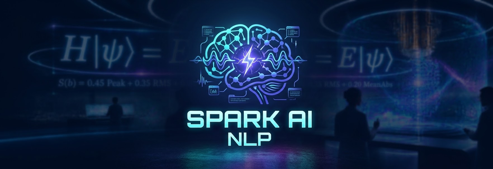

  

<h1 align="center">Jean-François Brisson · Spark AI NLP</h1>

  <b>Reproducible AI & optical-simulation software</b> 
  Evidence-first engineering · transparent benchmarks · interactive scientific demos

  
  
  
  
  

I build research software that makes claims **inspectable, rerunnable, and falsifiable**: telemetry anomaly detection, evidence auditing, RAG guardrails, digital holography, optical simulation, and interactive scientific tools.

**Core rule:** a result is useful only if another person can inspect its assumptions, rerun it, and see where it fails.

I am the founder of **Spark AI NLP**, a disability-led research-software initiative in Fredericton, New Brunswick, Canada. The portfolio spans classical simulation, browser demos, offline audit tools, numerical-contract testing, and C++/HLS prototypes. Each repository states its own evidence status and limitations.

## Try the science

| Demo | What it shows | Link |
|---|---|---|
| **Wavefront Clinic** | Correct Zernike aberrations, inspect the Fraunhofer PSF, and meet the Marechal Strehl criterion in an offline synthetic optics game. | [Open demo](https://github.com/sparkainlp-x/waveholo-telescope/blob/main/docs/game/index.html) |
| **WaveHolo game** | Interactive off-axis digital holography and focus estimation. | [Open demo](https://sparkainlp-x.github.io/waveholo/game/) |
| **Holographic Thoughts** | Accessibility-oriented interactive holographic-interface prototype. | [Open demo](https://sparkainlp-x.github.io/holographic-thoughts/) |
| **Spark Evidence Lab** | Rerunnable experiment cards, explicit baselines, uncertainty, and negative results. | [Open board](https://sparkainlp-x.github.io/spark-evidence-lab/) |

## Flagship work

### 1. [Spark Evidence Lab](https://github.com/sparkainlp-x/spark-evidence-lab)

**Reproducible experiment cards with explicit baselines and negative results.**

The evidence layer for this portfolio. Each card records the claim tested, conditions, baseline comparison, uncertainty, status, source commit, DOI where available, and rerun commands.

- Live board: <https://sparkainlp-x.github.io/spark-evidence-lab/>
- DOI: [10.5281/zenodo.23403169](https://doi.org/10.5281/zenodo.23403169)
- Verdicts: **Reproduced**, **Baseline stronger**, **Open question**, **Exploratory**

### 2. [WaveHolo](https://github.com/sparkainlp-x/waveholo)

**End-to-end off-axis digital holography: record, reconstruct, and estimate focus.**

Includes angular-spectrum reconstruction, sub-bin carrier estimation, focus estimation, a browser research sandbox, CI tests, and a real-data benchmark harness.

- Live demo: <https://sparkainlp-x.github.io/waveholo/game/>
- v0.1.5 DOI: [10.5281/zenodo.23653721](https://doi.org/10.5281/zenodo.23653721)
- Reported real-data check: 530 microscope holograms at 6 stage positions; a **slope check**, not an absolute-focus validation.

### 3. [WaveHolo Telescope](https://github.com/sparkainlp-x/waveholo-telescope)

**Synthetic telescope-pupil holography, Zernike wavefronts, and transparent metric failures.**

Benchmarks pupil-plane focus, recovered wavefront agreement, pipeline floor, and noise sensitivity. It reports that `phase_variance` does **not** locate focus on telescope-pupil data.

- Interactive game: [Wavefront Clinic](https://github.com/sparkainlp-x/waveholo-telescope/blob/main/docs/game/index.html)
- Status: **Synthetic only; no real telescope or instrument claim**

### 4. [OES Resilience](https://github.com/sparkainlp-x/oes-resilience)

**Telemetry anomaly detection evaluated under locked conditions.**

Tests anomaly-detection methods on public telemetry benchmarks, including NASA SMAP/MSL, with preregistered comparisons and transparent reporting.

- DOI: [10.5281/zenodo.23071166](https://doi.org/10.5281/zenodo.23071166)
- Published outcome: OES-32 and its locked v2 re-attempt did **not** meet their success criteria.

### 5. [OES-32 Residual](https://github.com/sparkainlp-x/oes32-residual)

**Cross-language numerical-contract testing.**

A JavaScript port validated against Python-generated contract vectors for bit-exact replay, with pinned source commits and CI regeneration.

### 6. [Evidence Passport](https://github.com/sparkainlp-x/evidence-passport)

**Provenance and disclosure infrastructure for AI experiments.**

Turns an experiment-run manifest into a static HTML evidence passport and normalized JSON. It records declared evidence and limitations; it does not re-score or validate evidence.

- Sample passports: <https://sparkainlp-x.github.io/evidence-passport/>
- DOI: [10.5281/zenodo.23165143](https://doi.org/10.5281/zenodo.23165143)

## Evidence snapshot

| Experiment | Status | Source |
|---|---|---|
| Blind NASA SMAP/MSL test, OES32 v1 vs baselines | **Baseline stronger / criterion not met** | [oes-resilience](https://github.com/sparkainlp-x/oes-resilience) |
| OES-32-v2 locked re-attempt | **Criterion not met** | [oes-resilience](https://github.com/sparkainlp-x/oes-resilience) |
| OES-32 residual JS port and live replay | **Reproduced** | [oes32-residual](https://github.com/sparkainlp-x/oes32-residual) |
| WaveHolo microscope slope check | **REPORTED; slope check, not absolute-focus validation** | [waveholo](https://github.com/sparkainlp-x/waveholo) |
| WaveHolo Telescope pupil reconstruction | **Synthetic; negative result for `phase_variance`** | [waveholo-telescope](https://github.com/sparkainlp-x/waveholo-telescope) |
| Surface-code memory toy, Stim + PyMatching | **Open question** | [qec-scaling-bench](https://github.com/sparkainlp-x/qec-scaling-bench) |

## Research principles

1. **Baselines first.** A method is meaningful only relative to a clearly specified alternative.
2. **Negative results are results.** Where a baseline wins, report it.
3. **Pin the evidence.** Claims link to commits, datasets, commands, or DOIs.
4. **Label uncertainty.** Reproduced, exploratory, and open questions are not equivalent.
5. **Separate simulation from reality.** Synthetic, browser, simulator-only, and hardware claims are distinguished.
6. **Make rerunning easy.** A clean checkout should be enough to reproduce a result.

## Technical focus

| Area | Representative work |
|---|---|
| Anomaly detection | [oes-resilience](https://github.com/sparkainlp-x/oes-resilience), [oes512q-latch](https://github.com/sparkainlp-x/oes512q-latch) |
| Evidence infrastructure | [spark-evidence-lab](https://github.com/sparkainlp-x/spark-evidence-lab), [evidence-passport](https://github.com/sparkainlp-x/evidence-passport) |
| Holography and optics | [waveholo](https://github.com/sparkainlp-x/waveholo), [waveholo-telescope](https://github.com/sparkainlp-x/waveholo-telescope) |
| RAG reliability | [spark-rag-guardrail](https://github.com/sparkainlp-x/spark-rag-guardrail) |
| Numerical contracts | [oes32-residual](https://github.com/sparkainlp-x/oes32-residual) |
| C++ / HLS | [oes32-hls](https://github.com/sparkainlp-x/oes32-hls), [qldpc_decoder_cpp](https://github.com/sparkainlp-x/qldpc_decoder_cpp) |
| Simulation | [qec-scaling-bench](https://github.com/sparkainlp-x/qec-scaling-bench), [membrane-crystallization](https://github.com/sparkainlp-x/membrane-crystallization) |
| Interactive systems | [thought-input-game](https://github.com/sparkainlp-x/thought-input-game), [world-holobridge](https://github.com/sparkainlp-x/world-holobridge) |

## Claims policy

- Results are **SYNTHETIC** unless a repository names a measured dataset and protocol, in which case they are **REPORTED**.
- No repository reports a result from quantum hardware, a physical membrane, a medical device, or a field deployment.
- FPGA synthesis, hardware-in-the-loop testing, and independent review are labelled **UNRUN** where not performed.
- Design goals are labelled **TARGET**.
- Claim corrections can be opened through the template in [sparkainlp-x/.github](https://github.com/sparkainlp-x/.github).

## Open to

- Applied-AI and research-software roles, remote within Canada or on site in Fredericton
- Research Software Engineer · Applied AI Engineer · ML Evaluation Engineer · Scientific Software Developer
- Collaboration with optics researchers, FPGA/decoder engineers, accessibility-focused partners, and research groups
- Independent replication and focused technical collaborations

## Contact

  <a href="https://sparkainlpx.xyz">Website</a> ·
  <a href="https://www.linkedin.com/in/jean-fran%C3%A7ois-brisson-41927b3a4">LinkedIn</a> ·
  <a href="https://orcid.org/0009-0000-9778-5374">ORCID</a> ·
  <a href="https://zenodo.org/communities/spark-ai-nlp/">Zenodo</a> ·
  <a href="PORTFOLIO.md">Full portfolio</a>

Français (langue maternelle) · English (fluent)

For the complete repository index, release snapshot, project tracks, acknowledgements, and citation records, see **[PORTFOLIO.md](PORTFOLIO.md)**.
