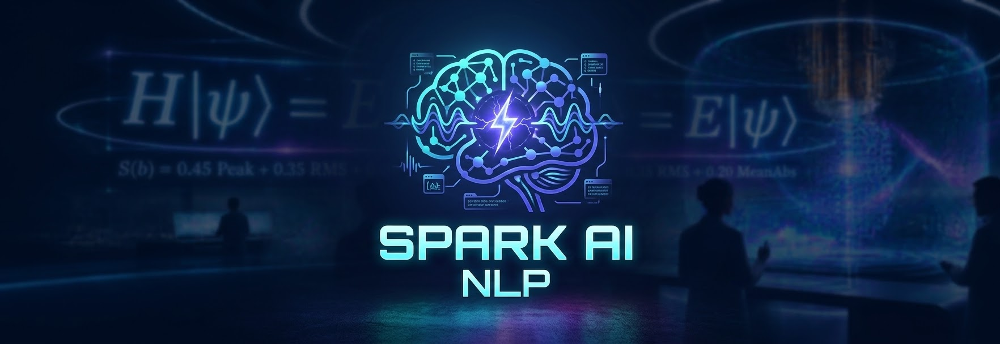

  

<h1 align="center">Spark AI NLP</h1>

  Disability-led research-software studio from Fredericton, New Brunswick. Current focus: Evidence Passport, an offline tool for packaging declared experiment evidence and checking release requirements. The broader repository set is a research portfolio, not a set of validated products.

  <a href="https://sparkainlpx.xyz">sparkainlpx.xyz</a> ·
  <a href="https://www.linkedin.com/in/jean-fran%C3%A7ois-brisson-41927b3a4">LinkedIn</a> ·
   ·
   
  Founder: Jean-François Brisson · Français (langue maternelle) · English (fluent)

> **Open to work:** applied AI research and research-software roles, remote within Canada or on site in Fredericton. See [Contact](#contact).

The public repositories are research software and prototypes. They are not hardware, field, or medical products, and they do not report results on quantum hardware. Evidence Passport is the flagship candidate, not a commercially validated product.

## Focus and portfolio hierarchy

- **Flagship candidate — [Evidence Passport](https://github.com/sparkainlp-x/evidence-passport):** offline evidence packaging and a local policy-based release gate. It records declared evidence and local hash consistency; it does not independently validate or re-score an experiment.

- **Supporting research — [OES-Resilience](https://github.com/sparkainlp-x/oes-resilience):** reproducible telemetry benchmark with detector comparisons and a preregistered NASA SMAP/MSL evaluation. **Outcome:** OES32 did not meet its stated success criterion on that evaluation; see the README for scope and results.

- **Experimental lab:** the remaining projects below are supporting research, prototypes, and educational demonstrations—not parallel commercial products. For example, [OES32-HLS](https://github.com/sparkainlp-x/oes32-hls) has software tests, while FPGA synthesis and hardware execution are UNRUN.

**Untested buyer hypothesis:** a small AI evaluation or research-software team that needs repeatable evidence packaging and release checks. The economic buyer, budget, current workflow displaced, and willingness to pay remain unverified. Manual checklists, internal scripts, CI checks, and existing governance/evaluation platforms are alternatives to assess—not markets already won.

**External validation status:** this profile does not claim a paid pilot, production deployment, independent replication, or recurring revenue. GitHub activity, code, tests, and DOIs are not presented as substitutes for customer evidence.

## Evidence labels

Project READMEs use these labels where they report evidence. Check each README for the details behind a REPORTED result.

- **SYNTHETIC:** generated inputs or simulation.
- **REPORTED:** measured by the project author; not independently reproduced.
- **TARGET:** a design goal; not yet measured or achieved.
- **UNRUN:** a planned or available run that has not been performed.

Code quality or reproducibility alone does not establish scientific validity.

## Supporting research and experimental lab

The following catalog is retained for transparency and citation; it is not a roadmap of multiple active products. Versions are the latest GitHub releases. DOIs are Zenodo concept DOIs (all versions).

Open the categorized repository index

Versions are the latest GitHub releases. DOIs are Zenodo concept DOIs (all versions).

### Telemetry benchmarks and detectors

- [oes-resilience](https://github.com/sparkainlp-x/oes-resilience) · v0.5.1: open, reproducible benchmark for 512-channel telemetry anomaly detection with the transparent OES32 reference detector, a stress suite, replay evaluation and a detector plugin API. Baseline results are SYNTHETIC. Release v0.5.0 added a preregistered evaluation on one public dataset (NASA SMAP/MSL) under one locked protocol; OES32 did **not** meet its stated success criterion there. [DOI 10.5281/zenodo.23071166](https://doi.org/10.5281/zenodo.23071166)
- [oes512q-latch](https://github.com/sparkainlp-x/oes512q-latch) · v0.2.1: classical OES-32/OES-512 residual latch with a self-calibrated threshold, compared with standard unsupervised detectors on all 47 labelled series of the public Numenta Anomaly Benchmark (NAB). Mixed results, reported as measured: best block ranking by average precision, behind CUSUM on F1. Not a quantum code. [DOI 10.5281/zenodo.22998570](https://doi.org/10.5281/zenodo.22998570)
- [multi-quantum-oes](https://github.com/sparkainlp-x/multi-quantum-oes) · v0.1.2: offline, standard-library OES-512 replay-triage workbench with a preregistered stress evaluation whose result is **negative** and published as such, plus an isolated "AI ∩ quantum" toy lab. SYNTHETIC data; exact classical simulation, not a QPU. [DOI 10.5281/zenodo.23113851](https://doi.org/10.5281/zenodo.23113851)
- [oes-telemetry-bench](https://github.com/sparkainlp-x/oes-telemetry-bench): offline replay bench for synchronized 32-channel OES32 telemetry frames, with a strict input contract and frozen thresholds; synthetic demo. [DOI 10.5281/zenodo.23175492](https://doi.org/10.5281/zenodo.23175492)
- [spark-membrane](https://github.com/sparkainlp-x/spark-membrane): fail-closed console that audits SYNTHETIC 32-channel frames against the OES repositories, pinned by commit SHA, with a hash-chained run trail, evidence passport and claims gate; thresholds uncalibrated; [demo page](https://sparkainlp-x.github.io/spark-membrane/). [DOI 10.5281/zenodo.23175490](https://doi.org/10.5281/zenodo.23175490)
- [homological-cascade-engine](https://github.com/sparkainlp-x/homological-cascade-engine): classical, synthetic signal-processing framework for chain-complex diffusion, Hodge residual scoring and streaming POT thresholds; not a QKD system or adaptive-optics hardware. Synthetic tests do not establish real-telemetry performance or operational false-alarm control. [DOI 10.5281/zenodo.23307846](https://doi.org/10.5281/zenodo.23307846)
- [oes512-telemetry-engine](https://github.com/sparkainlp-x/oes512-telemetry-engine): asynchronous Python prototype for 512-channel telemetry ingestion, DSP, and monitoring; see its README for current implementation scope. [DOI 10.5281/zenodo.23307953](https://doi.org/10.5281/zenodo.23307953)
- [oes32-dashboard](https://github.com/sparkainlp-x/oes32-dashboard): PyQt6/PyQtGraph desktop dashboard using synthetic stimuli; not a medical or field system. [DOI 10.5281/zenodo.23307955](https://doi.org/10.5281/zenodo.23307955)
- [flip-observer-1024](https://github.com/sparkainlp-x/flip-observer-1024): calibration prototype for a classical weighted readout under a hidden channel-order reversal (512 inputs, two noisy banks); SYNTHETIC; [demo page](https://sparkainlp-x.github.io/flip-observer-1024/). [DOI 10.5281/zenodo.23173449](https://doi.org/10.5281/zenodo.23173449)
- [pilottrace](https://github.com/sparkainlp-x/pilottrace): offline validation and block scoring of 512-value numeric trace frames. [DOI 10.5281/zenodo.23187278](https://doi.org/10.5281/zenodo.23187278)

### OES-32 contract and implementations

- [oes32-residual](https://github.com/sparkainlp-x/oes32-residual): the **normative** OES-32 residual (ADR-001), with contract tests in CI (Python 3.11–3.13). [DOI 10.5281/zenodo.22985520](https://doi.org/10.5281/zenodo.22985520)
- [oes32-hls](https://github.com/sparkainlp-x/oes32-hls) · v0.3.0: C++ HLS prototype of OES-32 triage with a streaming AXI4-Stream kernel, pybind11 bindings, and pytest + Hypothesis tests comparing it bit for bit with a Python reference model. `g++` testbenches and Python tests run in CI on SYNTHETIC stimuli; FPGA synthesis UNRUN (ZCU111 is a TARGET). [DOI 10.5281/zenodo.22985525](https://doi.org/10.5281/zenodo.22985525)
- [oes32-membrane-shield](https://github.com/sparkainlp-x/oes32-membrane-shield): 32-slot state machine gated by Ed25519 capabilities, with dual-approval calibration; unit, end-to-end and deterministic fuzz tests in CI; independent security review UNRUN. [DOI 10.5281/zenodo.22999276](https://doi.org/10.5281/zenodo.22999276)
- [oes32-membrane-array](https://github.com/sparkainlp-x/oes32-membrane-array): software-only scale-out wrapper for the fixed 32-slot OES32 membrane contract; generated inputs, no hardware or performance claims. [DOI 10.5281/zenodo.23307951](https://doi.org/10.5281/zenodo.23307951)
- [oes32_engine](https://github.com/sparkainlp-x/oes32_engine) and [oes512-residual](https://github.com/sparkainlp-x/oes512-residual): earlier related implementations; see each README for scope. DOIs [10.5281/zenodo.22985523](https://doi.org/10.5281/zenodo.22985523) and [10.5281/zenodo.22985532](https://doi.org/10.5281/zenodo.22985532)

### Evidence, provenance and claims audits

- [evidence-passport](https://github.com/sparkainlp-x/evidence-passport) · v0.1.0: offline standard-library audit tool that turns one experiment-run manifest into a static HTML evidence passport and normalized JSON (fail-closed SHA-256); it records declared evidence and never re-scores it. The bundled OES-Resilience SMAP/MSL sample keeps the verdict "criterion **not** met"; three further examples are labelled SYNTHETIC; [sample pages](https://sparkainlp-x.github.io/evidence-passport/). [DOI 10.5281/zenodo.23165143](https://doi.org/10.5281/zenodo.23165143)
- [quantum-claims-passport](https://github.com/sparkainlp-x/quantum-claims-passport) · v0.1.0: offline claims audit for scientific communication. It classifies public claims (a planned Swiss quantum-computer hub; a modeled 613 THz tubulin frequency band; a rat behavioral study) as announcement, computational model, animal behavioral result, hypothesis, or unsupported inference, with exact-SI conversions and no combined score. Source audit only, snapshot 2026-10-05; it makes none of the audited claims and has no affiliation with the institutions named; [report](https://sparkainlp-x.github.io/quantum-claims-passport/report.html). [DOI 10.5281/zenodo.23167801](https://doi.org/10.5281/zenodo.23167801)
- [measurement-trail](https://github.com/sparkainlp-x/measurement-trail): SHA-256 hash-chained measurement provenance trails. [DOI 10.5281/zenodo.23067465](https://doi.org/10.5281/zenodo.23067465)

### Retrieval-augmented generation

- [spark-rag-guardrail](https://github.com/sparkainlp-x/spark-rag-guardrail): source-grounded RAG (ChromaDB + Ollama) that refuses to answer when retrieval relevance is too low; tests on SYNTHETIC fixtures; answer quality UNRUN. [DOI 10.5281/zenodo.22999268](https://doi.org/10.5281/zenodo.22999268)

### Classical simulations and testbenches

None of these are quantum-hardware results.

- [digital-to-wave-testbench](https://github.com/sparkainlp-x/digital-to-wave-testbench) · v0.4.2: synthetic, dimensionless software testbench for a signed-amplitude sine encoding (noise, phase, CFO, timing; Wilson CIs). All results SYNTHETIC; no physical validity claimed. [DOI 10.5281/zenodo.23122876](https://doi.org/10.5281/zenodo.23122876)
- [qec-scaling-bench](https://github.com/sparkainlp-x/qec-scaling-bench): classical toy simulation of surface- and repetition-code memory scaling with Stim and PyMatching; seeded and reproducible, no hardware results. It covers the classical base scaling benchmark only. [DOI 10.5281/zenodo.23241631](https://doi.org/10.5281/zenodo.23241631)
- [qldpc_decoder_cpp](https://github.com/sparkainlp-x/qldpc_decoder_cpp): unfinished C++/HLS decoder scaffold; the belief-propagation kernel and correction checks are placeholders; HLS/HIL UNRUN. [DOI 10.5281/zenodo.22985527](https://doi.org/10.5281/zenodo.22985527)
- [quantum-error-correction-demo](https://github.com/sparkainlp-x/quantum-error-correction-demo): classical toy; no qubits, no QEC code. [DOI 10.5281/zenodo.22985530](https://doi.org/10.5281/zenodo.22985530)
- [phmt4-montecarlo](https://github.com/sparkainlp-x/phmt4-montecarlo): heuristic classical simulation. [DOI 10.5281/zenodo.22999270](https://doi.org/10.5281/zenodo.22999270)
- [oes-quantum-binaural-lab](https://github.com/sparkainlp-x/oes-quantum-binaural-lab): classical toy simulation with three separate lanes (Bell-correlation Monte Carlo, scalar metrics ledger, digital stereo loopback); SYNTHETIC. [DOI 10.5281/zenodo.23175494](https://doi.org/10.5281/zenodo.23175494)
- [thermoelectric-ledger](https://github.com/sparkainlp-x/thermoelectric-ledger): signed heat-flow accounting that withholds exergy and efficiency figures unless the uncertainty bounds support them; 104 contract tests in CI (MIT). [DOI 10.5281/zenodo.23241554](https://doi.org/10.5281/zenodo.23241554)
- [residual-gradient-workbench](https://github.com/sparkainlp-x/residual-gradient-workbench): browser workbench that keeps an OES-32 residual replay and a classical thermoelectric generator model in separate lanes; [demo page](https://sparkainlp-x.github.io/residual-gradient-workbench/). [DOI 10.5281/zenodo.23187280](https://doi.org/10.5281/zenodo.23187280)
- [coil-efficiency-bench](https://github.com/sparkainlp-x/coil-efficiency-bench): paired motor-efficiency analysis with a Student's t CI; bundled data SYNTHETIC. [DOI 10.5281/zenodo.23067995](https://doi.org/10.5281/zenodo.23067995)
- [conserved-message-graph-demo](https://github.com/sparkainlp-x/conserved-message-graph-demo): synthetic three-node graph-routing analogy; not general relativity or OES32. [DOI 10.5281/zenodo.23308959](https://doi.org/10.5281/zenodo.23308959)

### Offline data tools

- [context-wallet](https://github.com/sparkainlp-x/context-wallet): user-selected, short-lived JSON context packets (preview before export). [DOI 10.5281/zenodo.23061441](https://doi.org/10.5281/zenodo.23061441)
- [signal-commons](https://github.com/sparkainlp-x/signal-commons): coarse categorical incident postcards from 512-channel residual frames, without sharing raw data. [DOI 10.5281/zenodo.23049349](https://doi.org/10.5281/zenodo.23049349)
- [signal-test-commons](https://github.com/sparkainlp-x/signal-test-commons): deterministic synthetic challenge suite for 512-channel signal monitors. [DOI 10.5281/zenodo.23057992](https://doi.org/10.5281/zenodo.23057992)
- [internal-outage-radar](https://github.com/sparkainlp-x/internal-outage-radar): offline scope classification of multi-site service-check snapshots. [DOI 10.5281/zenodo.23057994](https://doi.org/10.5281/zenodo.23057994)
- [gnss-log-stats](https://github.com/sparkainlp-x/gnss-log-stats): local-only descriptive statistics for approved GNSS CSV logs; no receiver validation or physical-evidence claim. [DOI 10.5281/zenodo.23307945](https://doi.org/10.5281/zenodo.23307945)
- [web-delta-feed](https://github.com/sparkainlp-x/web-delta-feed): reproducible comparison reports for two saved text snapshots. [DOI 10.5281/zenodo.23069164](https://doi.org/10.5281/zenodo.23069164)
- [pocket-internet](https://github.com/sparkainlp-x/pocket-internet): offline exchange and merge of public-information bundles between disconnected devices. [DOI 10.5281/zenodo.23187284](https://doi.org/10.5281/zenodo.23187284)

### Demos and educational prototypes

- [signal-loom](https://github.com/sparkainlp-x/signal-loom): offline performance-art prototype in which synthetic signal streams drive an interactive visual score (MIT); [demo page](https://sparkainlp-x.github.io/signal-loom/). [DOI 10.5281/zenodo.23173453](https://doi.org/10.5281/zenodo.23173453)
- [empty-state-observatory](https://github.com/sparkainlp-x/empty-state-observatory): synthetic guessing game and benchmark; not physical-universe or hardware evidence. [DOI 10.5281/zenodo.23308961](https://doi.org/10.5281/zenodo.23308961)
- [max-slate-einstein](https://github.com/sparkainlp-x/max-slate-einstein): bounded educational character-engine prototype; not Einstein or historical authenticity. [DOI 10.5281/zenodo.23307947](https://doi.org/10.5281/zenodo.23307947)
- [spark-oes512-demo](https://github.com/sparkainlp-x/spark-oes512-demo): browser OES32-style demo; SYNTHETIC. [DOI 10.5281/zenodo.23187282](https://doi.org/10.5281/zenodo.23187282)
- [address-phase-demo](https://github.com/sparkainlp-x/address-phase-demo): French-language educational HTML; SYNTHETIC. [DOI 10.5281/zenodo.23129671](https://doi.org/10.5281/zenodo.23129671)

Repository documentation varies; check each README for its scope, limits, evidence status and setup.

## How I work

- **Contracts first.** Each definition lives in one normative place with executable tests. For OES-32 that is [oes32-residual@b77b612](https://github.com/sparkainlp-x/oes32-residual/tree/b77b61254f15778c6ae221843dceac7a8571158e) (ADR-001); other implementations are labelled Profile A sidecars and document how they differ.
- **Fail-closed where specified.** Selected READMEs label unrun or unmeasured work, and results are published with their caveats, including negative outcomes.
- **Reproducibility varies by project.** Some repositories document tested quickstarts, automated tests or CI; check the individual README and workflow.
- **Accessibility first.** Ask for alternative formats by opening an issue in any repository.

Contribution guidelines, the code of conduct and the security policy are shared across all repositories: [sparkainlp-x/.github](https://github.com/sparkainlp-x/.github).

## Cite

Use GitHub's **"Cite this repository"** button or the `CITATION.cff` and DOI links in each repository. Records are being added to the [Spark AI NLP: Research Software](https://zenodo.org/communities/spark-ai-nlp/) Zenodo community.

## Contact

Open to applied AI research and research-software roles (remote within Canada, or Fredericton, NB), and to collaboration with research groups, FPGA/decoder engineers, and accessibility-focused partners.

- Website: [sparkainlpx.xyz](https://sparkainlpx.xyz)
- LinkedIn: [Jean-François Brisson](https://www.linkedin.com/in/jean-fran%C3%A7ois-brisson-41927b3a4)
- ORCID: [0009-0000-9778-5374](https://orcid.org/0009-0000-9778-5374)
- Questions about code: open an issue in any repository
